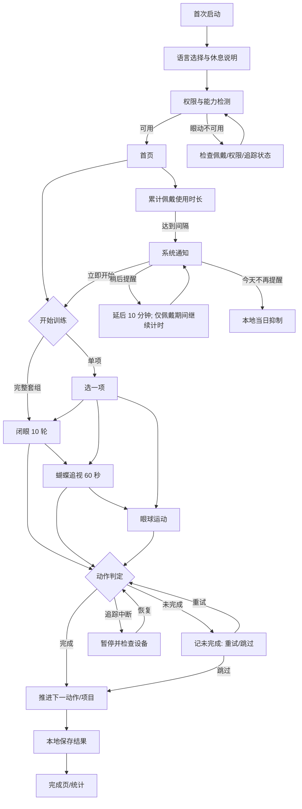

# 眨眨岛 / Blink Blink Island｜设计与开发交接包

版本：v0.1；目标设备：PICO Swan；开发目标：PICO Spatial。此文档衔接对话中已生成的两张概念素材板（岛屿角色板、空间 UI 板）；它们是概念稿，尚未拆分为可直接导入项目的图标、贴图和场景资源，也尚未产出音频文件。

## 1. 产品边界与能力门槛

- 面向佩戴头显期间的单人休息提醒；记录仅在设备本地存储。中英文界面和语音。允许完整套组或单独训练。
- 默认累计佩戴 60 分钟提醒，可设 30～120 分钟。摘下暂停计时，重新佩戴接续累计；未佩戴时不弹提醒；训练中不叠加提醒。
- 后台累计佩戴时长、跨应用系统通知、通知动作按钮、从通知直达指定页面、眼睑闭合状态、眼动轨迹、头部姿态、手势、控制器、凝视、用户中心头像昵称，都必须分别以当前 SDK 文档和 Swan 真机核验。没有验证结果，不写成已实现。
- 眼动追踪只能判断可观测的闭合状态、凝视位置及数据质量，不能证明闭眼力度、泪膜改善、视力提升。训练应定位为休息与视觉活动引导。头显的虚拟景深不能当作真实近远对焦。
- 训练中疼痛、眩晕或不适立即停止。避免高速轨迹、强闪光和刺激音；必要时显示「摘下头显休息」提示。具体动作参数可以通过产品配置调整，但默认值按本交接包。

## 2. 产品流程

注：单项训练结束直接进入保存结果，不再自动进入其他项目；完整套组结束进入摘要。若通知动作按钮或跳转能力无法实现，应先呈报限制并给出系统允许的实现方案。默认延后 10 分钟是设计建议，尚待产品确认。通知在不佩戴期间到期时应挂起，重新佩戴后再按平台许可提示，不追发多条历史通知。

## 3. 页面与交互规格

| 页面 | 核心内容 | 交互 |
| --- | --- | --- |
| 首启 | 语言、舒适说明、眼动权限说明、能力自检 | 继续、检查设备 |
| 首页 | 头像/昵称（可用时）、开始完整套组、单项入口、今日状态 | 手势/控制器/凝视 |
| 训练选择 | 三项目卡片、预计时长、完整套组入口 | 选择/返回 |
| 闭眼 | 10 轮进度、听觉倒计时、轻柔背景；闭眼时无需盯住屏幕 | 暂停、退出 |
| 蝴蝶 | 60 秒进度、舒适轨迹、自然眨眼提示 | 暂停、重试 |
| 扫视 | 左右 10、上下 10、顺时针 5、逆时针 5；空间目标 | 暂停、重试 |
| 未完成 | 说明本动作未完成、独立的重试/跳过按钮 | 重试/跳过，不自动计成功 |
| 数据中断 | 暂停所有训练计时、检查佩戴/追踪/权限 | 恢复后继续/退出 |
| 完成 | 各项目完成、未完成、跳过、退出次数 | 返回/查看统计 |
| 统计 | 历史、各项目完成情况、总次数 | 查看日期 |
| 设置 | 提醒 30～120 分钟、语言、BGM/音效/语音音量、舒适度 | 调整/静音 |

凝视按钮应有可见的停留进度与可取消反馈；实际停留时间、点击面积和空间距离通过 Swan 可用交互规范及真机试用确定。避免闭眼时要求视觉确认。所有项目在眼动质量不足时暂停；头动判定须容许正常小幅动作，阈值先标为待标定。

## 4. 双语界面文案

| 场景/键 | 简体中文 | English |
| --- | --- | --- |
| app.name | 眨眨岛 | Blink Blink Island |
| home.greeting | 让眼睛休息一下 | Give your eyes a little break |
| home.full | 开始完整训练 | Start full session |
| home.single | 单项训练 | Choose an activity |
| activity.blink | 闭眼休息 | Close and rest |
| activity.butterfly | 蝴蝶漫游 | Butterfly glide |
| activity.gaze | 眼球运动 | Eye movements |
| blink.instruction | 完整闭眼，轻轻收紧眼睑，保持 3 秒；不要按压眼球。 | Close your eyes fully and gently squeeze your eyelids for 3 seconds. Do not press on your eyes. |
| blink.detected | 检测到闭眼，保持一会儿。 | Eyes closed. Hold gently. |
| blink.open | 现在可以睁开眼睛。 | You can open your eyes now. |
| blink.progress | 第 {current} / {total} 次 | Round {current} of {total} |
| butterfly.instruction | 头部保持自然稳定，用视线缓慢跟随蝴蝶。可以自然眨眼。 | Keep your head comfortably steady and follow the butterfly with your eyes. Blink naturally. |
| gaze.horizontal | 看向左边，再看向右边，回到左边算一次。 | Look left, then right, then back left for one round. |
| gaze.vertical | 看向上方，再看向下方，回到上方算一次。 | Look up, then down, then back up for one round. |
| gaze.clockwise | 顺时针看完一整圈。 | Follow one full clockwise circle. |
| gaze.counter | 逆时针看完一整圈。 | Follow one full counterclockwise circle. |
| activity.incomplete | 这次动作尚未完成。 | This move was not completed. |
| action.retry | 重试 | Retry |
| action.skip | 跳过 | Skip |
| action.pause | 暂停 | Pause |
| action.resume | 继续 | Resume |
| tracking.lost | 暂停训练。请检查佩戴、眼动权限或追踪状态。 | Session paused. Check the headset fit, eye tracking permission, or tracking status. |
| comfort.stop | 如果感到疼痛、眩晕或不适，请停止训练并摘下头显休息。 | If you feel pain, dizziness, or discomfort, stop and remove the headset to rest. |
| reminder.body | 已连续使用一段时间，来眨眨岛休息一下吧。 | You've been using your headset for a while. Take a break on Blink Blink Island. |
| reminder.now | 立即开始 | Start now |
| reminder.later | 稍后提醒 | Remind me later |
| reminder.today | 今天不再提醒 | No more today |
| stats.title | 我的休息记录 | My activity history |
| stats.complete | 已完成 | Completed |
| stats.incomplete | 未完成 | Not completed |
| stats.skipped | 已跳过 | Skipped |
| stats.exited | 中途退出 | Left early |
| settings.interval | 提醒间隔 | Reminder interval |
| settings.audio | 背景音乐 / 音效 / 语音 | Music / Sounds / Voice |

翻译需由母语审阅；上表是首版文案，不暗示医疗效果。

## 5. 语音引导脚本与音频触发

语音为独立于音效的可关闭轨道；完整音频录制或语音生成需要单独制作与授权。短语音首次引导优先，重复轮次减少打断；可通过音量设置调节。下表中音效为制作规格，不代表现有文件已交付。

| 事件 | 中文播报 / 英文播报 | 音效方案与触发条件 |
| --- | --- | --- |
| 进入闭眼项目 | 请闭上眼睛，轻轻收紧眼睑，保持三秒。/ Close your eyes fully and gently squeeze for three seconds. | 温柔木琴起始音 250–400 ms；仅入场一次 |
| 检测到闭眼 | 已闭眼。/ Eyes closed. | 单次柔软水滴音 120–250 ms；从睁到闭且追踪可靠时触发 |
| 持续闭眼 | 保持一会儿。/ Hold gently. | 极轻的连续柔和风声，200 ms 渐入，闭眼期间循环；中断/睁眼渐出 |
| 倒计时 | 三、二、一。/ Three, two, one. | 三次低响度木质点音，与计时同步；语音可选 |
| 允许睁眼 | 可以睁开眼睛。/ You can open your eyes now. | 上行两音符 250–500 ms，闭眼满 3 秒后仅触发一次 |
| 动作通过 | 做得好。/ Well done. | 一声柔和叶铃 150–300 ms；一动作一次 |
| 未完成 | 这次还没完成，可以重试或跳过。/ Not completed. Retry or skip. | 单一低柔提示音，不用刺耳警报 |
| 追踪丢失 | 训练已暂停，请检查设备。/ Session paused. Check your headset. | 单次下行提示音；连续异常不重复刷音 |
| 蝴蝶项目 | 跟着蝴蝶慢慢移动视线，可以自然眨眼。/ Follow the butterfly slowly. You may blink naturally. | 蝴蝶轨迹使用间歇微弱空气声，禁止持续追踪音 |
| 扫视项目 | 保持头部自然稳定，跟随目标移动视线。/ Keep your head comfortably steady and follow the target. | 每一完整往返/圈通过时才发轻音 |
| 完成 | 今天的休息训练完成了。/ Your break is complete. | 1–2 秒舒缓短旋律；不可盖过语音 |
| 跨应用提醒 | 根据系统通知能力选择是否附提示音 | 单次短促、低音量；遵从系统勿扰与通知权限 |

BGM：岛屿环境氛围，约 60–80 BPM 的舒缓节奏感或无明显节拍；柔和风、水、少量鸟鸣；避开尖锐高频、强左右声像与突然音量跃迁；做可无缝循环的 60–120 秒母带与独立环境层。训练中 BGM 自动压低 6–10 dB 让位于语音及关键提示；闭眼持续音应较语音低 12 dB 以上；音量数值先作为混音目标，真机试听再调。三组独立音量、总静音、无语音时依然有可访问的音效/界面反馈。音频资产清单：`bgm_island_loop`、`amb_wind_loop`、`amb_water_loop`、`sfx_count_tick`、`sfx_eyes_closed`、`sfx_eyes_holding_loop`、`sfx_eyes_open`、`sfx_success`、`sfx_incomplete`、`sfx_tracking_pause`、`sfx_reminder`、`sfx_session_complete`，以及 `voice_zh`/`voice_en` 对应的全部播报文件。目标导出格式与空间声接口按实际 SDK 规格决定。

## 6. 训练判定与记录约定

- 闭眼：可靠检测到闭合后启动 3 秒计时；短暂噪声抖动应做容差处理，阈值在真机标定；计满后提示可睁眼，检测到睁眼后完成这一轮。闭眼不足 3 秒记一次未完成事件，用户可重试同轮或跳过同轮。自然眨眼不能误计入闭眼训练。
- 蝴蝶：60 秒按可评价的追视片段统计。眨眼期间短暂停止评价，不记失败；头动过大提示稳定头部，不能用头动直接判成眼球追视成功。连续追踪质量差触发暂停。追视完成阈值需通过真机标定，不能按时间自动算成功。
- 扫视：按有顺序的目标区域命中与视线轨迹计数；左右及上下各一来回为一次，顺/逆时针各完整一圈为一次；头动幅度超阈值时该动作未通过。目标位置约在用户前方舒适空间，不将画面渲染距离等同于实际焦距。
- 数据字段建议：`sessionId`、`localDate`、`activityType`、`startedAt`、`endedAt`、`outcome`、`attemptedCount`、`completedCount`、`incompleteCount`、`skippedCount`、`interruptedCount`、`trackingInterruptedDurationMs`、`appVersion`。仅记录统计所必需的数据，不默认存储原始眼动轨迹。明确设备本地持久化及删除数据入口。

## 7. 视觉稿到可用素材的制作任务

已生成的是概念图。下一轮须以单独输出的资源制作：图标（方形、透明背景）、蝴蝶角色（透明背景、正侧视与张翅状态）、闭眼与圆周目标标记（透明背景）、岛屿场景分层（前景/中景/远景）、每页 UI 高保真设计及交互态（正常/悬停/选中/禁用/暂停）。为避免生成图中文字乱码，所有最终文字由应用代码排版。为每份资产记录源文件、尺寸、颜色空间、透明度、授权来源和导出规范。对于 3D 资产需另外制作网格、纹理与动画；单张概念图不能直接当作 3D 场景。

## 8. 开发任务顺序与验收

1. PICO CLI 环境核对与 setup；安装/写入范围按安装指南核准。检查官方 API 文档并建立能力矩阵。
2. Swan 真机最小验证项目：眼动与闭眼状态、头部运动、佩戴切换、后台通知和通知跳转、用户资料；逐项保存可复现的验证步骤与结果。
3. 设计交付复核：独立可用视觉素材、中文/英文界面稿、音频母带与文件、页面和状态机规格；用户确认后才实施正式业务功能。
4. 基础应用：主页/训练选择/设置/本地数据/语言/资料读取与降级展示。
5. 训练实现：闭眼→蝴蝶→扫视，加入追踪质量处理、暂停、重试/跳过和头动判定。按真机数据标定阈值。
6. 提醒实现：累计佩戴时长、通知动作、后台唤起、稍后/今日静默；遵从系统实际能力与通知权限。
7. 真机验收：佩戴与摘下切换、跨应用通知、通知跳转、眼动丢失恢复、三输入方式、中英切换、静音、训练记录准确性和舒适度。逐项报告通过/失败/未测，附复现步骤。

当前完成状态：两张视觉概念素材板已在当前对话生成；本交接包已形成双语文案、操作流程、音频制作清单与开发任务。尚未生成独立可导入的图片资源、实际音频文件、可运行项目或 Swan 真机验证结果。
